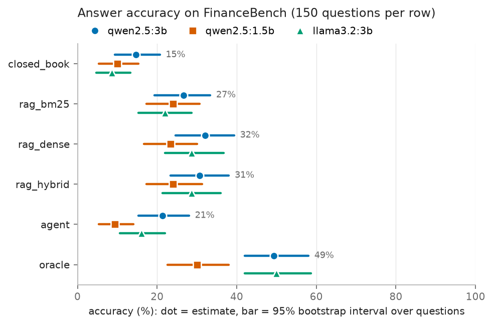
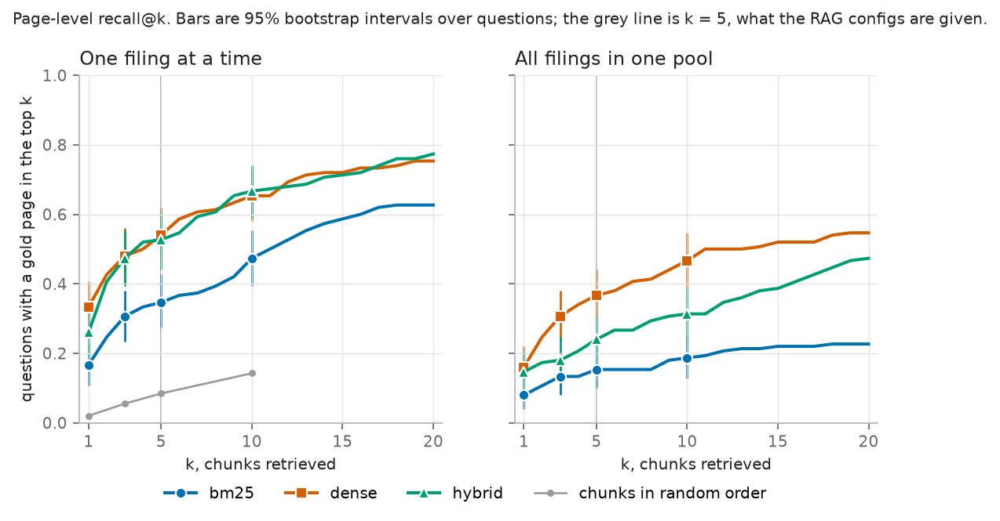

# Question answering over company filings

FinanceBench (Islam et al., 2023) is a set of questions about real company filings, written by financial analysts, each with the answer and the page of the filing it comes from. In the paper, GPT-4-Turbo with one vector store shared by all the filings got 81% of them wrong or refused to answer. With a separate store for each filing, which is the setting used here, it got half of them right, and with the evidence pages pasted in, 85%. I wanted to see how far small models running on my own machine get (1.5 to 3 billion parameters, on a 4GB GTX 1050 Ti), and more usefully, where their answers go wrong: not finding the right page, or getting it wrong with the right page in front of them.

The open-source sample is 150 questions over 84 filings from 32 companies. Each question is answered six ways: with no filing at all (closed book); with the top five passages from BM25, from a dense retriever or from a hybrid of the two (RAG); with the gold evidence pages pasted in (the oracle, which shows what a model does once retrieval is perfect); and by a small agent that can search the filing and use a calculator. Questions whose gold answer is a single number are graded by comparing numbers. The rest go to a larger local model as a judge, and its agreement with the automatic grade is measured on the questions where both apply.

The short version, accuracy % over the 150 questions with 95% bootstrap intervals:

| config | qwen2.5:3b | llama3.2:3b | qwen2.5:1.5b |
|:--|:--|:--|:--|
| closed_book | 14.7 [9.3, 20.7] | 8.7 [4.7, 13.3] | 10.0 [5.3, 15.3] |
| rag_bm25 | 26.7 [19.3, 33.3] | 22.0 [15.3, 28.7] | 24.0 [17.3, 30.7] |
| rag_dense | 32.0 [24.7, 39.3] | 28.7 [22.0, 36.7] | 23.3 [16.7, 30.0] |
| rag_hybrid | 30.7 [23.3, 38.0] | 28.7 [21.3, 36.0] | 24.0 [17.3, 31.3] |
| agent | 21.3 [15.3, 28.0] | 16.0 [10.7, 22.0] | 9.3 [5.3, 14.0] |
| oracle | 49.3 [42.0, 58.0] | 50.0 [42.0, 58.7] | 30.0 [22.7, 38.0] |



- With the dense or hybrid retriever, every model gets more than twice as many questions right as it does on its own. For qwen2.5:3b, RAG with the hybrid retriever is 16.0 points above closed book [+6.7, +25.3], paired over the same questions.
- Even handed the right pages, the 3B models get half the questions wrong, so better retrieval on its own has a ceiling. The oracle is 18.7 points above hybrid RAG for qwen2.5:3b [+9.3, +28.7]. Of the 104 questions qwen2.5:3b got wrong with hybrid RAG, 63 never had a gold page in front of the model, and 41 had one and still got it wrong.
- The agent is worse than plain RAG with the same retriever, for all three models (-9.3 [-17.3, -1.3] points for qwen2.5:3b, -12.7 [-20.7, -5.3] for llama3.2:3b, -14.7 [-22.0, -8.0] for qwen2.5:1.5b). For llama3.2:3b and qwen2.5:1.5b that is almost all questions they never searched: llama3.2:3b skipped the search in 47 questions and got none of them right, and qwen2.5:1.5b searched in only 7 of the 150. When llama3.2:3b did search, its keyword queries found a gold page about as often as the question itself. qwen2.5:3b searched nearly every time, and its queries found one 9 points less often than the question [-19.9, +0.7].
- Small models copy examples. A worked example in the calculator's description got called with its own numbers in 32 of llama3.2:3b's 150 questions, and an example figure in the system prompt came back as a whole answer in a smoke test. The prompts now use placeholders, which still get copied now and then (see Answering).
- The judge agrees with the automatic grade on 93.5% [90.9, 95.8] of the 1,116 numeric answers where both apply (Cohen's kappa 0.81). That is the only check on it: how it does on the text answers it grades alone is not measured.

## Reproduce

```
pip install -r requirements.txt
pip install -e .
python scripts/01_download.py        # questions and the 84 filings from the FinanceBench repo
python scripts/02_ingest.py          # pages and chunks, and the page-number check
python scripts/03_index.py           # bge-small embeddings, about 45 minutes on a CPU
python scripts/04_retrieval_eval.py
ollama pull qwen2.5:3b               # and llama3.2:3b, qwen2.5:1.5b, and qwen2.5:7b for the judge
python scripts/05_answer.py --config rag_hybrid --model qwen2.5:3b   # once per config and model
python scripts/06_score.py           # grading, and the judge
python scripts/07_report.py          # figures
python scripts/08_agent_report.py    # what the agent did
python -m pytest
```

The tables and intervals below are copied from `reports/` (`page_alignment.md`, `retrieval.md`, `accuracy.md`, `agent.md`), which the scripts write from the answers and verdicts in `results/`, so if a number here disagrees with a report, the report is right. A few counts in the text I took straight from `results/` and the raw data, and the memory and slowdown figures under Speed from Ollama's own logs. Generation uses temperature 0 and a fixed seed, but that does not make it exactly repeatable: for question 00746, rag_dense and rag_hybrid retrieved the same five chunks, so qwen2.5:3b got the same prompt twice, and its two replies differ. `05_answer.py` picks up where it stopped, so a run can be killed and restarted.

My GPU driver turned out to be too old for the CUDA build Ollama ships: every model load crashed with "the provided PTX was compiled with an unsupported toolchain". Rather than update the driver mid-project, I ran a second Ollama server with CUDA hidden and the Vulkan library selected (`CUDA_VISIBLE_DEVICES=-1 OLLAMA_LLM_LIBRARY=vulkan`), so it runs on Ollama's Vulkan backend on the same card, and pointed the scripts at it with `OLLAMA_HOST`. The judge ran on the CPU through a third server (`OLLAMA_VULKAN=0 OLLAMA_LLM_LIBRARY=cpu`) at the same time. That cost the two Qwen models under 1% of their answering time, but llama3.2:3b, which had four of its layers on the CPU (see Speed), generated about a fifth slower while the judge was running.

## The data

The 150 questions come in three kinds of 50:

- metrics-generated: a figure worked out from the financial statements. FinanceBench tags 14 of them as information extraction, a single line item like "What is the FY2018 capital expenditure amount (in USD millions) for 3M? Give a response to the question by relying on the details shown in the cash flow statement." The other 36 need arithmetic, mostly ratios and margins, some averaged over three years, and 23 of them use two statements.
- domain-relevant: what an analyst would ask about any company. "Is 3M a capital-intensive business based on FY2022 data?"
- novel-generated: written by the annotators for that filing. "If we exclude the impact of M&A, which segment has dragged down 3M's overall growth in 2022?"

The 84 filings are 64 10-Ks, 8 10-Qs, 6 8-Ks and 6 earnings releases, from 2015 to 2024. I parse them with pymupdf: 12,013 pages, 65 of them with no text layer, none of them an evidence page. 29 of those are in Walmart's 2019 10-K, where an exhibit at the end is stored as page images; its text is on the page after each image in white, so the parse still has it.

Retrieval is scored against FinanceBench's evidence page numbers, so before using them I checked them. Each evidence item comes with the text of its page as FinanceBench extracted it, and I compared that with my parse at the stated page and one either side. All 189 evidence items match at the stated page with no offset, with a character 5-gram overlap of 1.00 on every one; the best score on a neighbouring page is 0.54. Word overlap would have been harder to use. On some statement pages FinanceBench's text has the spaces dropped ("Cashandcashequivalents"), and on those the right page scores as low as 0.35 on words, below the 0.63 a neighbouring page reaches elsewhere, so no single cutoff on words separates right pages from neighbours (within each item the right page still scores highest). 115 questions have one gold page, 33 have two and 2 have three.

Chunks are 200-word windows with a 40-word overlap that never cross a page, so every chunk has exactly one page number: 41,525 chunks, 177 words on average, between 7 and 1,565 per filing (median 447).

## Retrieval

- BM25, written out by hand with numpy and scipy.sparse (k1 = 1.5, b = 0.75, the Lucene form of the idf so it never goes negative). The tokeniser lowercases, drops thousands separators so "1,577" matches "1577", turns "FY2018" and "FY18" into "2018" because the filings almost never say FY, and drops a short stopword list.
- Dense: bge-small-en-v1.5 (384 dimensions) through sentence-transformers, with its query prefix. Embedding the 41,525 chunks took 46 minutes on the CPU.
- Hybrid: reciprocal rank fusion of the two rankings, with the usual constant of 60.

Each question searches only its own filing, as in the paper's single-store setting, and BM25 takes its statistics from that filing alone. A hit at k means at least one of the top k chunks is on a gold page. Intervals are 95% bootstraps over questions, and every comparison is paired, using the same resampled questions for both methods.

| method | recall@1 | recall@3 | recall@5 | recall@10 | MRR |
|:--|:--|:--|:--|:--|:--|
| bm25 | 0.167 [0.107, 0.227] | 0.307 [0.233, 0.380] | 0.347 [0.273, 0.427] | 0.473 [0.393, 0.553] | 0.269 [0.211, 0.328] |
| dense | 0.333 [0.260, 0.407] | 0.480 [0.407, 0.560] | 0.540 [0.467, 0.620] | 0.653 [0.580, 0.727] | 0.439 [0.376, 0.505] |
| hybrid | 0.260 [0.193, 0.333] | 0.473 [0.393, 0.553] | 0.527 [0.440, 0.607] | 0.667 [0.587, 0.740] | 0.398 [0.337, 0.461] |
| random order | 0.020 | 0.055 | 0.084 | 0.142 | |

- Dense retrieval is the clear winner over BM25: +19 points of recall@5 [+10, +29] and +0.17 MRR [+0.10, +0.24].
- Fusing in BM25 does not help. Against dense alone, hybrid is 7 points worse at rank 1 [-14, -1] and no different at 3, 5 or 10 (recall@5 -1 point [-9, +5]).
- The gap is all in the numbers questions. On the 50 metrics-generated questions BM25 finds a gold page in its top 5 for 18% of them and dense for 76%. The questions use an analyst's words and the statements use their own: one asks for Amcor's "net AR", and the balance sheet says "Trade receivables, net". BM25 first reaches that page at rank 56, dense at rank 1. On the novel-generated questions, which tend to name the thing they ask about, BM25 is ahead (60% against 54%, within the noise).
- Questions that need two or three pages are where everything struggles. Of the 35, BM25 never gets all of their gold pages into its top 10, and dense manages it for 34%.

With every filing in one pool (the paper's shared store) the right filing comes back in the top 5 for 80% of questions with dense retrieval and 55% with BM25, and a gold page for 37% and 15%. Most of the loss from pooling is the same company's other years: dense finds the right company in its top 5 for 94% of questions. In the pool the hybrid is worse than dense alone at every k past 1 (gold page@5 -13 points [-19, -7]), because BM25 on its own is so poor there. The answering experiments use the single-filing setting.



## Answering

Every config uses the same system prompt (answer from the filing, show the working briefly, end with one line `Answer: <value with unit>`), an 8,192-token window, temperature 0 and seed 0.

- closed_book: the question, the company and the name of the filing.
- rag_bm25, rag_dense, rag_hybrid: the top 5 chunks from that retriever, labelled with their page numbers, then the question. Five chunks come to about 920 words.
- oracle: the full text of the gold evidence pages. The code cuts them to fit the window if it has to, but none came close: for qwen2.5:3b the longest oracle prompt was 3,122 tokens. This is the only config that ever sees which pages are gold.
- agent: Ollama's native tool calling with two tools. `search(query)` returns the top 5 hybrid chunks of this filing for whatever query the model writes, so each search differs from rag_hybrid's retrieval only in its query. The model also decides whether to search and how often, and its prompt is different: it carries the tool descriptions, and the passages come back as tool results after the question. `calculate(expression)` does arithmetic by walking the expression's syntax tree, so nothing the model writes is ever run as Python. The model gets up to five calls with the tools on offer, and its first reply without a tool call is the answer. Only if all five end in tool calls, or a reply is empty or a tool call too garbled to read, does one more call without the tools ask for the final answer; no question needed all five. Tool calls that a small model writes into its reply as JSON instead of through the API are picked up too. When the conversation would overflow the window, old search results are dropped, oldest first, never ones the model has not seen yet; those are cut short instead if they still do not fit.

Models, all through Ollama with its default 4-bit quantisation: qwen2.5:3b is the main one, with llama3.2:3b and qwen2.5:1.5b for comparison.

Two things about prompting small models caught me out. The system prompt first showed the answer format with real figures, and in the smoke test qwen2.5:3b's whole reply to a question whose excerpts lacked the answer was the example itself, "Answer: $2.4 billion" (those answers are in `results/smoke_test/`). The examples became placeholders, `$X.X billion` and `X.X%`, before any full run. Those get copied too, but they cannot pass for a figure: 4 of the 2,700 final replies have the placeholder in their answer line, and none is graded correct. 20 of qwen2.5:1.5b's replies to yes/no questions were the prompt's own template, "Answer: Yes, ..." with no reason given; in all 20 the yes or no matched the reference, and the judge counted them correct.

The second one cost me a rerun of the agent. The calculator's description had a worked example, `(2453 - 2108) / 2108 * 100`, and llama3.2:3b called the tool with those numbers in 32 of its 150 questions, often without having searched, and gave the result as its answer. Those first runs are kept in `results/agent_tool_example/`, and the ones in the tables use a description with no figures in it. llama3.2:3b then copied the placeholder formula instead, `(new - old) / old * 100`, word for word in 14 questions and garbled in a 15th. The calculator rejects that, so no number comes back from the tool, but in 7 of those 15 it was the only tool call, the model never searched, and its answer used figures it had not been shown. A test now checks that no prompt text the models see has a figure in it.

## Grading

62 of the 150 questions have a gold answer that is a single number (50 metrics-generated, 3 domain-relevant, 9 novel-generated). Those are graded automatically from the reply's `Answer:` line, or from its last non-empty line if it has none:

- correct if a number there is within 1% of the gold, or within half a unit of the gold's last decimal place or of the place the question asks for, whichever is finer (some golds are rounded to one significant figure; a whole-number gold gets only the 1%), with 25% and 0.25 counted as equal;
- a bare number is read in the unit the question asks for, so "1,577" answers "in USD millions";
- a money figure off by a factor of a thousand, million or billion is wrong, and labelled a unit error;
- for capex and dividends, a minus sign copied from the cash flow statement ("Dividends paid (389)") does not count against the answer;
- two different figures of the same kind joined by "or" ("$389 million or $3.89 billion") are a hedge, and wrong however close one of them is.

One gold is corrected before grading: 05718 asks for American Water Works' FY2020 dividends in USD billions, the filing says 389 million, and the gold is "$0.40", which marks the filing's own figure wrong at two decimal places. It is graded against $0.39 (`GOLD_FIXES` in `fqa/score.py`).

The 1% is generous for ratios: it passes 31.0% for a gold of 30.8%, and 1.74 for 1.73. So the report also has a strict grade, where the answer and the gold must agree at the coarser of their two precisions (63.9 days still passes for 63.86; 63.59 does not). FinanceBench writes the money golds of the metrics questions to two decimals whatever the filing says ("$1616.00" for Amcor's $1,615.9 million, "$4.60" for PepsiCo's $4,625 million), so trailing zeros there are not counted as precision.

The other 88 questions go to qwen2.5:7b as a judge. It sees the question, the gold answer, the analyst's working where FinanceBench gives one (half of these 88 have none) and the reply, never which config or model wrote it. It answers two yes/no questions in JSON: does the reply commit to an answer, and does that answer agree with the reference. The verdict is worked out from those: refused if it does not commit, correct if it agrees, incorrect otherwise. The first version asked the judge for the verdict directly, and on the closed-book answers it would write "the answer does not commit to an answer" as its reason and then give a verdict of correct. Its verdicts are in `results/judge_v1/`.

To check the judge, it also marks every numerically graded answer, where the automatic grade is the reference. Over 1,116 of them it agrees 93.5% of the time [90.9, 95.8] (Cohen's kappa 0.81, correct against not). It is the stricter of the two: of the 73 disagreements, 41 are answers the grader accepts and the judge rejects, and many of those are format slips on the judge's side, such as rejecting "$5,818 million" against a gold of "$5818.00", or 80.13% against 0.8. It also accepted 9 of the 26 unit errors. That is the only check on it. The questions it grades alone come with the analyst's working less often (half of them, against 56 of the 62 numeric ones), and a sentence is harder to compare than a number, so I would expect it to do worse on them, but that is not measured.

## Results

Most of these are in `reports/accuracy.md`, and the agent's in `reports/agent.md`. Intervals are 95% bootstraps over questions, and differences are paired: both configs scored on the same resampled questions.

Paired differences for qwen2.5:3b, in points of accuracy:

| comparison | difference [95% CI] |
|:--|:--|
| rag_bm25 - closed_book | +12.0 [+4.0, +19.3] |
| rag_dense - closed_book | +17.3 [+8.0, +26.7] |
| rag_hybrid - closed_book | +16.0 [+6.7, +25.3] |
| rag_dense - rag_hybrid | +1.3 [-5.3, +8.0] |
| agent - rag_hybrid | -9.3 [-17.3, -1.3] |
| oracle - rag_hybrid | +18.7 [+9.3, +28.7] |

**Retrieval.** For the two 3B models the better retrievers give somewhat better answers, though less clearly than recall@5 would suggest: dense and hybrid are 5 and 4 points above BM25 for qwen2.5:3b and 7 and 7 for llama3.2:3b, all with intervals that include zero. qwen2.5:1.5b gains nothing, though dense retrieval shows it a gold page more often (54% of questions against 35% with BM25). The difference is concentrated where the retrieval eval said it would be. On the 50 metrics-generated questions qwen2.5:3b goes from 18% with BM25 to 36% with dense retrieval and 26% with the hybrid.

**Reading.** With the gold pages pasted in, qwen2.5:3b gets 49.3% and llama3.2:3b 50.0%, and qwen2.5:1.5b 30.0% on the same pages, so model size matters most here. Most of the oracle's wrong numeric answers are not near misses: of qwen2.5:3b's 35, 24 are more than 25% away from the gold. On the strict grade llama3.2:3b's oracle answers lose the most of any config and model (numeric accuracy goes from 51.6% to 33.9%), so many of its passes are close to the gold without matching it to the precision given. For qwen2.5:3b it is rag_dense that loses most (37.1% to 25.8%), and qwen2.5:1.5b loses nothing anywhere.

**Closed book.** On the 62 numeric questions closed book is right 0 to 3 times out of 62 for every model; the models do not know 3M's 2018 capex. On the other 88 they get 14% to 22%.

**Why answers were wrong**, qwen2.5:3b (each wrong answer gets the first label that applies):

| config | wrong | unit error | retrieval miss | refusal | other | gold page shown % |
|:--|--:|--:|--:|--:|--:|--:|
| closed_book | 128 | 0 | - | 33 | 95 | |
| rag_bm25 | 110 | 1 | 82 | 2 | 25 | 34.7 |
| rag_dense | 102 | 0 | 59 | 0 | 43 | 54.0 |
| rag_hybrid | 104 | 2 | 63 | 2 | 37 | 52.7 |
| agent | 118 | 0 | 76 | 2 | 40 | 40.7 |
| oracle | 76 | 2 | - | 4 | 70 | |

A retrieval miss means no chunk the model was shown came from a gold page. "Other" is any other wrong answer: in the configs that show filing text, the model had a gold page in front of it and still got it wrong, and closed book is shown nothing, so its 95 are wrong from memory.

### The agent

`reports/agent.md` has the details. The search tool is the same hybrid retriever with the same k as rag_hybrid, so each search differs from rag_hybrid's only in its query. But the model also decides whether to search at all, and a question it never searches shows it nothing.

| | qwen2.5:3b | llama3.2:3b | qwen2.5:1.5b |
|:--|:--|:--|:--|
| questions with no search | 9 | 47 | 143 |
| one search | 125 | 97 | 7 |
| two or more | 16 | 6 | 0 |
| words in the first query (questions average 27) | 5.4 | 7.1 | 6.0 |
| gold page shown, agent | 40.7% | 32.7% | 1.3% |
| gold page shown, rag_hybrid | 52.7% | 52.7% | 52.7% |
| difference, points [95% CI] | -12.0 [-22.0, -3.3] | -20.0 [-28.7, -12.0] | -51.3 [-59.3, -43.3] |
| the same, on the questions it searched | -9.2 [-19.9, +0.7] | +2.9 [-2.9, +8.7] | -28.6 [-57.1, +0.0] |
| right on the questions it did not search, agent vs rag_hybrid | 11.1% vs 55.6% | 0.0% vs 34.0% | 9.8% vs 25.2% |
| calculate calls (of which failed) | 10 (0) | 71 (71) | 3 (3) |

For llama3.2:3b and qwen2.5:1.5b the gap is almost all questions they never searched. llama3.2:3b skipped the search in 47 questions, most of them ones where the question itself would have found a gold page (70%), and got none of them right; when it did search, its queries found a gold page about as often as the question did. It also called the calculator 71 times, and every call failed: it wrote the formula in words, "(capex / revenue) * 100", rather than putting in numbers from the filing, and 14 of the calls were the description's placeholder word for word. qwen2.5:1.5b searched in only 7 of the 150 questions and answered the rest from memory, so as an agent it is close to a closed-book model. qwen2.5:3b searched in 141 questions with a short keyword query, 5.4 words on average ("FY2018 capital expenditure 3M"), and on those its searches showed it a gold page 9 points less often than the question did, though the interval just includes zero. Against rag_hybrid the agent loses for every model.

### Speed

On the 1050 Ti through Vulkan, qwen2.5:3b processes about 207 prompt tokens a second and generates about 32, so a RAG answer (about 1,700 to 2,000 prompt tokens and 100 generated) takes 10 to 13 seconds, closed book 3 seconds and the agent 15. qwen2.5:1.5b is about twice as fast on both counts, 4 to 5 seconds a RAG answer. llama3.2:3b generates at 21 to 22 tokens a second on the RAG configs, slower than qwen2.5:3b. With an 8,192-token context it needed 2.9GB, which would have fitted, but Ollama keeps 1GB of the card free by default, so it put 25 of the 29 layers (about 92% of the model) on the card and ran the other four on the CPU, where they competed with the judge. In the few minutes the judge was idle, llama3.2:3b generated about 27 tokens a second. Prompt speed counts only the tokens Ollama processed, not the ones it reused from the previous request, which for qwen2.5:3b's agent is more than a third of its prompt. The full table is in `reports/accuracy.md`.

## What I would do next

- Retrieval for statement pages. Dense retrieval still misses a gold page on 12 of the 50 metrics questions, and on the 38 where it puts one in front of qwen2.5:3b, the model does as well as with the whole gold pages (18 right either way), so what is left there is recall. The chunks keep each line item next to its figures, but the later chunks of a page lose the statement's title and the years at the top of its columns. Putting those back at the start of every chunk is the first thing I would try.
- A bigger reader. The oracle ceiling at 50% for 3B models is the hard limit here, and a 7B model fits on this card only partly.
- Make the agent start where RAG does: run the question itself as the first search, and let the model refine from there. qwen2.5:3b's own searching loses it 12 points of retrieval, and the other two models often do not search at all.
- Check the judge by hand on a sample of the text questions. Nothing here checks it on those yet.
- Everything here is one run at temperature 0 on 150 questions. A paired interval of ±8 points is the resolution, so differences of 4 or 5 points between configs are not findings.
